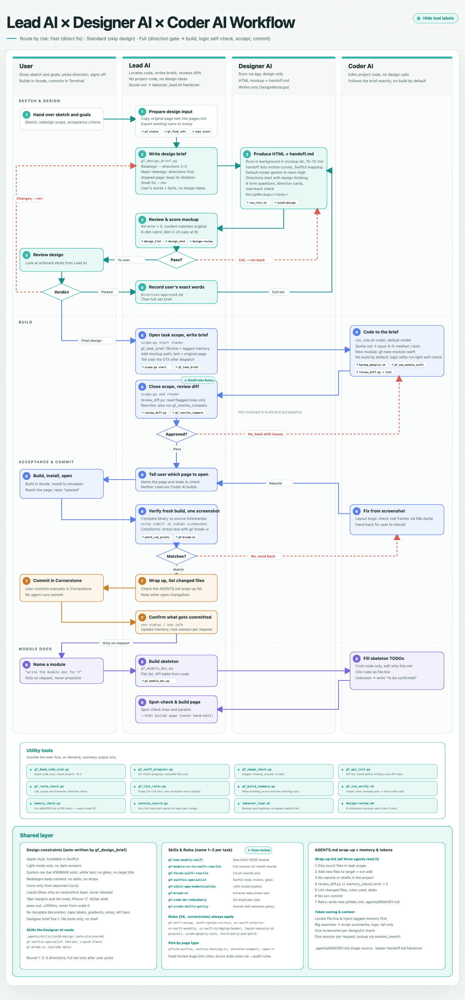
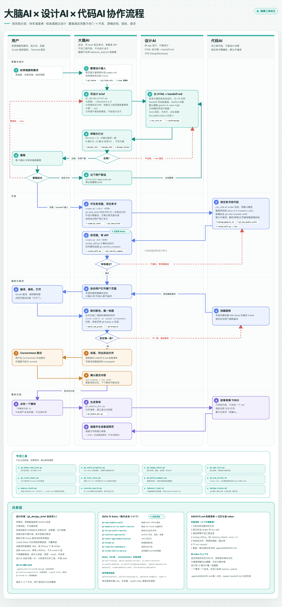

# lead-coder-designer

A model-agnostic SOP skill for running a **lead** agent with two executor agents — a **coder** and a **designer** — on real product work. The lead locates code, writes briefs, reviews diffs and verifies on device; the coder edits code; the designer produces HTML mockups. The user approves design directions and does the final acceptance.

Which CLI and model plays each role lives in one config file, so you can swap Cursor ↔ Codex ↔ Claude Code ↔ Gemini (agy) ↔ aider without touching the docs. It also works with **a single model** (see "One model only").

[中文说明见下方](#中文)

## Workflow chart



Interactive version (toggle tool labels): [English](https://happyiosyuan.github.io/lead-coder-designer/workflow-en.html) · [中文](https://happyiosyuan.github.io/lead-coder-designer/workflow.html)

The chart is the author's real iOS setup. Labels such as `scope.py`, `review_diff.py`, `design_lint.py` and `run_role.sh` are in this repo; the remaining `gf_*` labels are that project's own helper scripts, shown as examples of what to build for your project.

## What's inside

| Path | Purpose |
|---|---|
| `SKILL.md` | The SOP the lead agent follows (English); Chinese: `SKILL.zh-CN.md` |
| `config.example.sh` | Role → adapter / model / fallback models |
| `scripts/run_role.sh` | Run the coder or designer; auto-falls back to the next model when quota runs out; `--probe` health check |
| `scripts/adapters/` | One small file per CLI: `cursor-agent`, `codex`, `claude`, `agy`, `aider` |
| `scripts/scope.py` | Snapshot before/after a task and collect only *this* task's changes (git file list or svn changelist) |
| `scripts/review_diff.py` | Diff pre-review: changed files, untracked files, out-of-scope files, debug leftovers, pluggable project rules, automatic memory check |
| `scripts/design_lint.py` | Mockup lint: anti-template decoration, external assets, ease-in, content parity vs. old mockup / old source strings |
| `scripts/memory_check.py` | Check `.agents/MEMORY.md` (line cap, `[tag]`, near-duplicates, dead paths) and `--match` relevant entries into briefs |
| `scripts/session_search.py` | Search past local session transcripts without an LLM to verify previous user rulings |
| `scripts/takeover_lead.sh` | Hand over the lead role to a backup CLI via shared `leader-handoff.md` when quota runs out |
| `templates/` | Coder brief, design brief, directions (with design thinking), direction approval, report, module doc |
| `references/` | Design gate, 6-dimension design review rubric, review checklist, worst-case UI stress test, runtime verification, memory & lead handover, token saving, pitfalls, module doc |
| `examples/ios-uikit-swiftui/` | A real (redacted) iOS project setup |

## Requirements

- bash, Python 3.8+, git or svn
- The CLIs you configure (any subset): `cursor-agent`, `codex`, `claude`, `agy`, `aider`
- For screenshots: whatever your platform uses (`xcrun simctl`, `adb`, headless Chrome, `screencapture` …); see `references/runtime-verify.md`

## Install

Copy (or clone) the folder where your lead agent discovers skills:

| Lead agent | Location |
|---|---|
| Claude Code | `~/.claude/skills/lead-coder-designer/` (all projects) or `<project>/.claude/skills/` |
| Cursor | `<project>/.cursor/skills/lead-coder-designer/` |
| Codex / Gemini / Antigravity | `<project>/.agents/skills/lead-coder-designer/` |
| Anything else | Point the agent at `SKILL.md` |

```bash
git clone https://github.com/HappyiOSYuan/lead-coder-designer ~/.claude/skills/lead-coder-designer
cd <your project>
mkdir -p .sop && cp ~/.claude/skills/lead-coder-designer/config.example.sh .sop/config.sh   # edit it
~/.claude/skills/lead-coder-designer/scripts/run_role.sh --probe coder
~/.claude/skills/lead-coder-designer/scripts/run_role.sh --probe designer
```

Then create an `AGENTS.md` at your project root (roles, rule index, per-task checklist). `examples/ios-uikit-swiftui/AGENTS.excerpt.md` is a starting point.

## The flow

Route by risk first (**Fast**: ≤2 files / clear fix → locate, edit, `review_diff`; **Standard**: features / refactors → skip design; **Full**: new visuals / redesigns → full flow below):

```
request → locate → design (Full) → direction gate (user picks) → full mockup
        → coder brief → coder (isolated scope) → lead review (+ logic self-check)
        → on-device acceptance → wrap-up & retro → (module doc, on request)
```

The user commits; the lead never does. Periodically prune stale rules/skills with `scripts/memory_check.py --audit-rules`.

## One model only

The three roles are a division of labour, not three models.

- **Same model, separate sessions (recommended):** set coder and designer to the same CLI/model. Each `run_role.sh` call starts a fresh session that sees only the brief, so the review stays independent of the author's context.
- **Same model, sub-agents (no CLI needed):** if the lead's agent can spawn sub-agents (e.g. Claude Code's Agent tool, Cursor background agents), hand the brief to a sub-agent instead of `run_role.sh`. It starts with a clean context and sees only the brief, so you keep the author/reviewer separation without any extra CLI or `config.sh`. Don't use a mode that inherits the lead's context.
- **Single session, all three roles (no CLI needed):** no `run_role.sh`, no `config.sh`. The lead plays every role in order but keeps every gate: stop after design directions, write the brief before coding, run `review_diff.py` / `design_lint.py` and the review checklist before handing over. Self-review is weaker, so don't skip the scripts or the user's acceptance.

Without a CLI, what you get depends on where the lead runs:

| Lead runs in | Without a CLI |
|---|---|
| A coding agent that can read/write files and run commands (Claude Code, Cursor, Codex …) | Everything works; the scripts only need Python and git/svn |
| Web chat with no file access | Process only (direction gate, brief template, review checklist); checks are done by hand |

## Adding a CLI

Write `scripts/adapters/<name>.sh` with `ADAPTER_QUOTA_RE` and an `adapter_run <model> <workdir> <extra_dir> <prompt>` function (~20 lines; see `scripts/adapters/README.md`), set `CODER_ADAPTER=<name>`, run `--probe`.

## License

MIT

---

## 中文

一套**模型不锁死**的多代理协作 SOP：一个主控代理带编码、设计两个执行代理做真实需求。主控定位代码、写任务书、审 diff、上设备验收；编码改代码；设计出 HTML 设计稿；用户选设计方向、做最终验收。

- 谁来演哪个角色、用什么模型，都在 `config.sh` 一个文件里；换模型改一行，换 CLI 加一个约 20 行的适配器。主控额度耗尽时也可用 `scripts/takeover_lead.sh` + 共用 `leader-handoff.md` 平滑接管。
- 内置**轻/中/重三级分流**（小修直走快车道、重构跳过设计、大改版走完整方向门）、设计稿 6 维打分表（`references/design-review.md`）、动态逻辑自检与最坏数据 UI 压测（`references/ui-stress-test.md`），以及 `.agents/MEMORY.md` 唯一项目记忆体检、规则清理审计（`--audit-rules`）与历史会话检索（`scripts/memory_check.py`、`scripts/session_search.py`）。
- **单个模型也能用**，三种方式：
  - 编码和设计填同一个 CLI/模型，分开会话（推荐）；
  - 主控代理能起子代理时（如 Claude Code 的 Agent 工具），把任务书交给子代理，**不需要 CLI 和 config.sh**，上下文同样是分开的；
  - 单个会话里主控按顺序扮演三个角色，**不需要 CLI 和 config.sh**，但方向门、任务书、脚本检查、用户验收一道都不能省。
  - 在能读写文件、跑命令的编码代理里，脚本照常可用；只有网页聊天时只能用流程和清单，检查靠人工。
- 安装：把整个目录放到主控代理的 skills 目录（见上面的表），复制 `config.example.sh` 到项目的 `.sop/config.sh` 填好，`run_role.sh --probe` 探活，然后在项目根建 `AGENTS.md`。
- 流程图（中文版）：

  

  交互版 https://happyiosyuan.github.io/lead-coder-designer/workflow.html 。图里 `gf_*` 开头的是作者 iOS 项目自己的辅助脚本，仅作示例。
- `SKILL.md` 是英文版，`SKILL.zh-CN.md` 是中文版（想让代理读中文，把它改名为 `SKILL.md`）；模板和参考文档目前是中文；`examples/ios-uikit-swiftui/` 是一个真实 iOS 项目（已脱敏）的接入示例。
