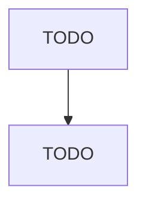

# <模块名>

> 生成日期：<YYYY-MM-DD> · 依据：代码 + 本次任务记录；看不出来的写「待确认」

## 模块概述
TODO：这个模块做什么、谁用、入口在哪。

## 页面清单
| 页面 | 文件 | 作用 |
|---|---|---|

## 接口
| 接口 | 方法 | 用途 | 关键参数 | 返回要点 | 调用位置 |
|---|---|---|---|---|---|

#### <接口名> 请求字段
TODO（多层字段表放在 #### 标题下）

## 业务逻辑
### <子模块>
#### <场景>
- TODO：规则（`文件:行号`）

## 流程

## 和其他模块的关系
TODO

## 已知问题与建议
TODO

## 变更记录
| 日期 | 改动 | 涉及段落 |
|---|---|---|
